[English](README.md) | [Cómo funciona (en inglés)](docs/HOW-IT-WORKS.md)

# Deskworlds

Aves, animales y el clima real de tu ciudad sobre tu escritorio de Windows, más un pequeño widget en la barra de tareas.

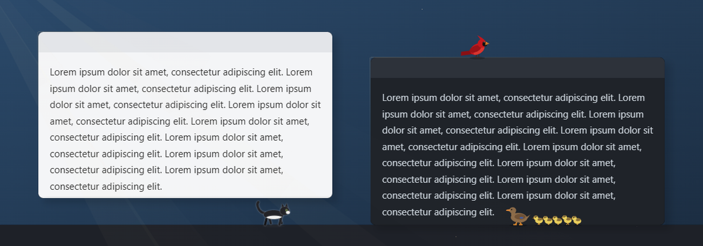

Un cardenal, un gato y unos patos comparten un escritorio iluminado por rayos de sol.

**[Descargar Deskworlds para Windows](https://github.com/giogardant/deskworlds-releases/releases/latest/download/Deskworlds-Setup.exe)**

Gratis · Unos 66 MB · Windows 10 u 11 de 64 bits (Windows 10 versión 1809 o posterior)

## Qué es

Hecho por Giovanni para familiares y amigos. Sin cuentas, anuncios ni registros. El clima aparece sobre tus ventanas, las aves se posan en sus bordes y los animales caminan por la barra de tareas. Al abrirlo por primera vez, conserva tu fondo de pantalla; puedes elegir fondos animados en **World**.

## Instalación

1. Descarga [Deskworlds-Setup.exe](https://github.com/giogardant/deskworlds-releases/releases/latest/download/Deskworlds-Setup.exe).
2. Ábrelo. Se instala solo para tu usuario y no requiere permisos de administrador.
3. Si Windows muestra **Windows protegió su PC**, elige **Más información** y luego **Ejecutar de todas formas**. La app no tiene firma de código.
4. Inicia Deskworlds. La bienvenida te pide tu ciudad o código postal para consultar el clima. Yuky llega trotando para saludarte.

El instalador incluye .NET e instala Microsoft WebView2 si hace falta.

## Galería de funciones

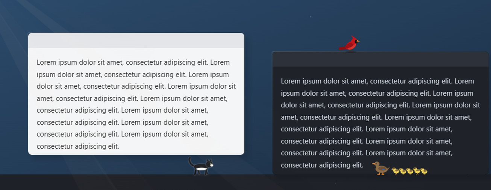

Los rayos de sol iluminan un cardenal posado, un gato y una fila de patos.

La luz sigue la posición calculada del sol. Las ventanas proyectan sombras suaves y las sombras de las nubes cruzan las pantallas.

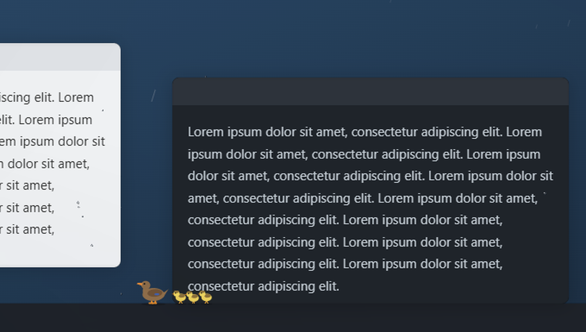

Un pato y tres patitos caminan bajo unas ventanas salpicadas de lluvia.

La lluvia cae sobre los bordes superiores de las ventanas y corre por el cristal. También hay nieve y neblina.

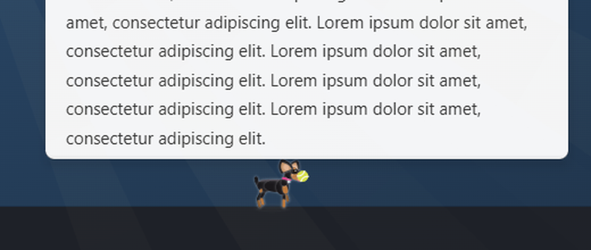

Yuky lleva una pelota de tenis por la barra de tareas.

Yuky es la pinscher miniatura de Giovanni y la mascota de la app. Lánzale la pelota para que la traiga de vuelta.

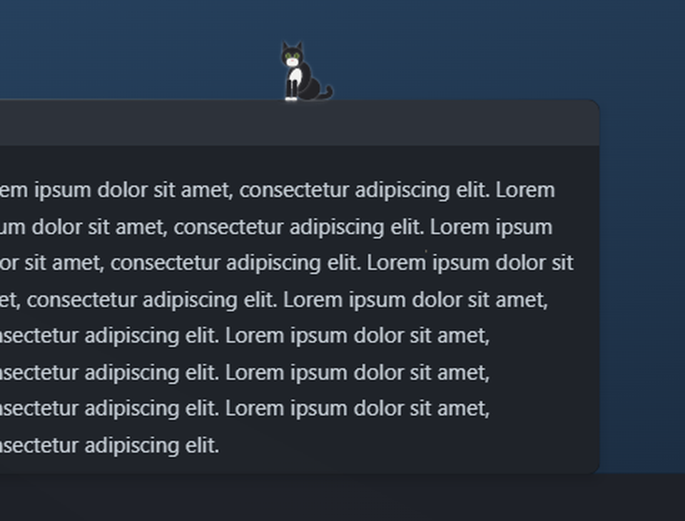

Un gato está sentado sobre una ventana del escritorio.

Los gatos y las ardillas trepan por los bordes de las ventanas. Los gatos pueden descansar arriba.

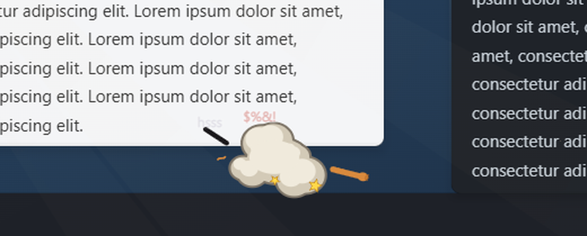

El gato y el perro se pelean en una nube de polvo de dibujos animados junto a una ventana.

Los gatos y los perros se pelean en una nube de polvo de dibujos animados. Los gatos pueden subirse a las tortugas.

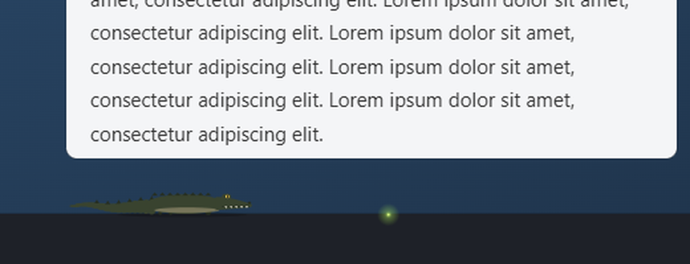

Un caimán comparte la barra de tareas con una luciérnaga luminosa por la noche.

En las noches cálidas y despejadas aparecen luciérnagas. También pueden salir armadillos y, en ocasiones, caimanes.

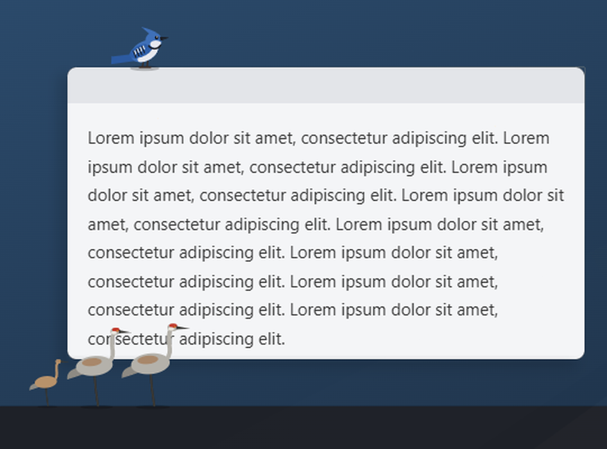

Un arrendajo azul se posa sobre una ventana mientras unas grullas están en la barra de tareas.

El escritorio recibe visitas de aves, colibríes y mariposas. Entre las visitas poco comunes hay grullas canadienses y anolis verdes.

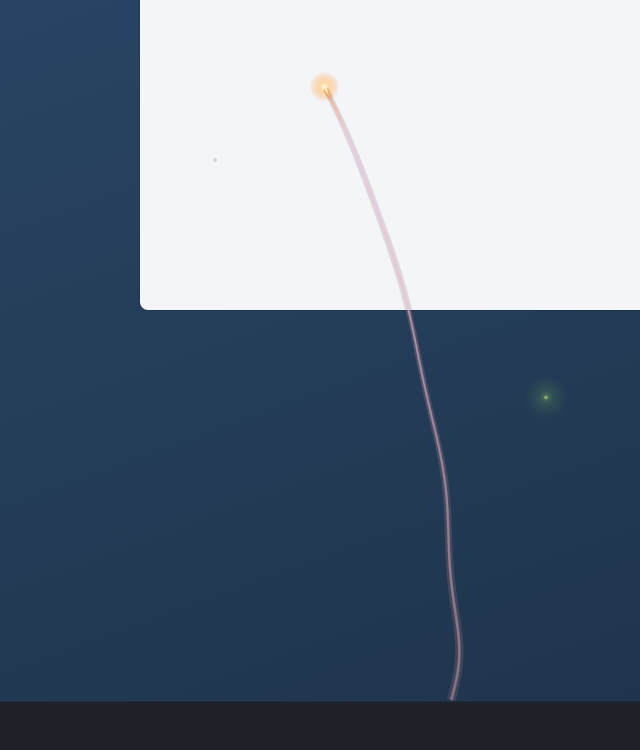

Un cohete luminoso asciende desde la barra de tareas dejando una larga estela curva.

A unos 320 km (200 millas) o menos de Cabo Cañaveral, una animación de cohete sigue la hora programada del lanzamiento. Depende del último horario recibido y del clima; puede no reflejar cambios de último momento.

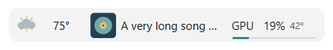

La barra compacta muestra el tiempo, la música y los datos de la GPU.

La barra compacta muestra el clima, la música y el uso de la GPU. Arrástrala hacia los lados para moverla.

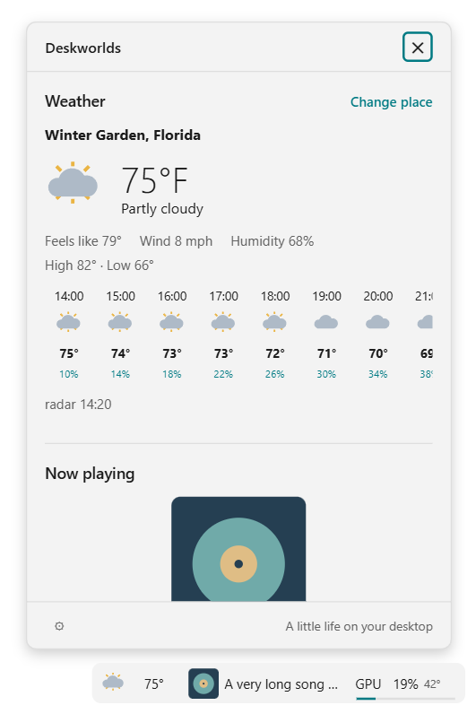

El panel del tiempo muestra un cielo parcialmente nublado y el pronóstico por horas sobre la barra compacta.

Haz clic en la sección del clima para ver las condiciones actuales y el pronóstico por horas.

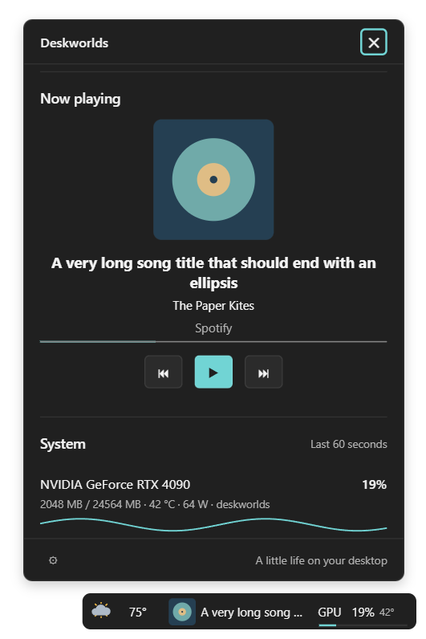

El panel multimedia muestra la canción actual, los controles de reproducción y los datos de la GPU.

Los controles funcionan con Spotify y otros reproductores que comparten su sesión multimedia con Windows. No necesitas iniciar sesión en Deskworlds.

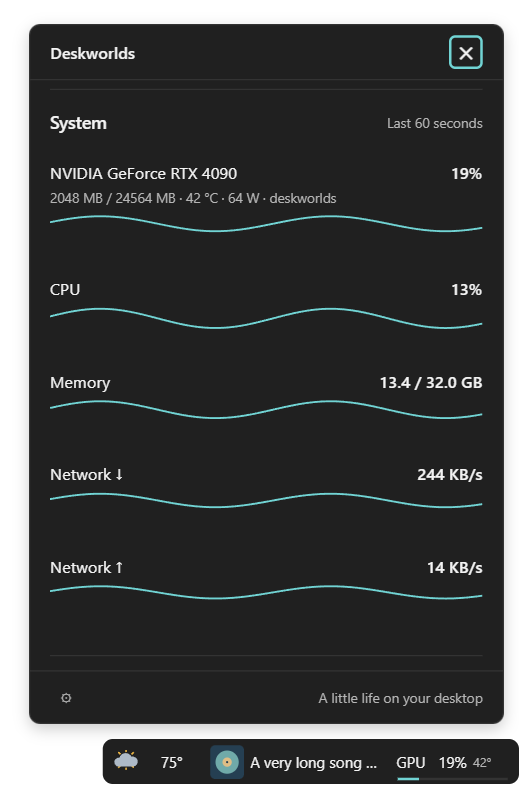

El panel del sistema muestra datos de la GPU, la CPU, la memoria y la red.

El panel del sistema muestra datos de la GPU, la CPU, la memoria y la red.

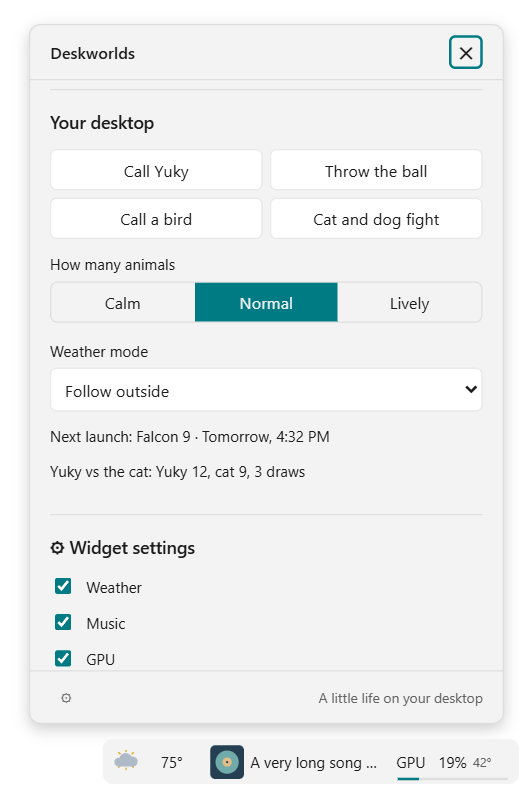

El panel del escritorio ofrece acciones de animales, opciones del tiempo y ajustes del widget.

El panel del escritorio incluye acciones de animales, opciones del clima y ajustes del widget.

## Cómo usarlo

- Haz clic en un animal para acariciarlo. Arrástralo y suéltalo para colocarlo; haz clic derecho para dejarlo ir. Puede caerse si sacudes o cierras su ventana. Su posición no se conserva al reiniciar la app.
- Busca el icono de olas turquesa junto al reloj (haz clic en `^` si está oculto). Haz clic derecho para abrir el menú.
- **Weather** → **Animals** → **Field guide** cuenta las especies vistas y las caricias. Con el widget activado, **Open the panel** abre las acciones y **How many animals**: **Calm** (tranquilo), **Normal**, **Lively** (animado). Si lo desactivas, esas acciones aparecen en el menú, incluida **Throw the ball** para lanzar la pelota.
- En **Weather**, usa **Effects**, **Follow the weather outside**, **Opposite of outside** o **Choose the weather** para ajustar los efectos y el clima. Elige tu ubicación con **Choose a place…** o **Change place…**.
- **Taskbar widget** activa o desactiva el widget. Necesita espacio libre en una barra de tareas horizontal; se oculta si la barra se oculta automáticamente o no hay un espacio seguro.
- **Start with Windows** controla el inicio con Windows; **Quit** cierra la app. Los nombres del menú están en inglés.

La capa transparente deja pasar los clics a tus programas, excepto sobre las zonas de interacción de los animales. El widget también recibe clics. Por defecto, las capas solicitan quedar fuera de las capturas y grabaciones; el resultado depende de la herramienta de captura. Puedes cambiarlo en **Weather** → **Show in screenshots and recordings**.

## Actualizaciones

Busca actualizaciones unos dos minutos después de iniciar y luego cada 24 horas. Las descarga por HTTPS, verifica el hash SHA-256 del archivo contra el publicado y las instala tras tres minutos sin actividad. La app se cierra y vuelve a abrir, conservando los ajustes y la opción de inicio. Omite las comprobaciones cuando Windows informa que la conexión es de uso medido.

Desmarca **Update automatically** para instalar manualmente; las comprobaciones y descargas continúan. Usa **Check for updates** para buscar una actualización. Cuando está lista, el menú ofrece **Install update** seguido del número de versión.

## ¿Es seguro? / Privacidad

La app no tiene rastreo ni analíticas. No tiene firma de código, por lo que Windows puede mostrar una advertencia.

Las búsquedas envían la ciudad o el código postal que escribes a Open-Meteo. Las consultas del clima envían las coordenadas elegidas a Open-Meteo; RainViewer recibe solicitudes de imágenes de radar de esa zona. Launch Library 2 proporciona los horarios del Cabo y GitHub recibe consultas y descargas de actualizaciones. Si falta WebView2, su instalador también se conecta a Microsoft. Estos servicios reciben información normal de conexión, como tu dirección IP.

Los ajustes, la guía de campo, los datos del navegador y los registros se guardan localmente en `%LOCALAPPDATA%\Deskworlds`.

## Preguntas frecuentes

### No se ve nada

Revisa **Pause everything**, **Weather** → **Show on top of windows** y **Screens** en el menú. Las apps en pantalla completa ocultan las capas en las pantallas que ocupan. Prueba **Weather** → **Animals** → **Call an animal** para llamar a un visitante. Una ventana maximizada no deja un borde superior expuesto donde pueda posarse un ave.

### ¿Cómo lo pauso?

**Pause the wallpaper** pausa el fondo animado y deja activos el clima, los animales y el widget. **Pause everything** también oculta las capas y limita el muestreo del widget; este puede seguir mostrando datos. Desmarca la opción para reanudar.

### ¿Cómo lo desinstalo?

En la Configuración de Windows, abre **Aplicaciones**, busca **Deskworlds** en **Aplicaciones instaladas** (Windows 11) o **Aplicaciones y características** (Windows 10) y elige **Desinstalar**. Los ajustes, la guía de campo y los datos del navegador se conservan para una futura instalación.

### ¿Hace lenta mi computadora?

El consumo depende de los efectos, el fondo y el equipo. Una medición con clima ambiental en cuatro monitores fue de unos 0.2 de un núcleo de CPU (16 de noviembre de 2026); no es una garantía. **Pause everything** reduce el consumo a casi cero. Los fondos animados pueden consumir más, especialmente en laptops.

### ¿Puedo usar dos monitores?

Sí. **Screens** permite elegir las pantallas activas. El clima abarca varias pantallas y los animales pueden cruzar entre las que se tocan en la distribución de Windows, incluso con escalas distintas.

### ¿Qué pasa con los juegos?

La detección de pantalla completa oculta y detiene las capas en las pantallas ocupadas. Los fondos también dejan de dibujarse cuando quedan cubiertos. El widget y la app pueden seguir trabajando en segundo plano.

## Créditos

- Hecho por Giovanni para familiares y amigos.
- Riverbed, Coral reef, Betta, Plasma globe y Koi pond provienen de [chaseleantj/deskworlds](https://github.com/chaseleantj/deskworlds) (MIT).
- Clima: [Open-Meteo](https://open-meteo.com/). Radar: [RainViewer](https://www.rainviewer.com/). Horarios de lanzamientos: [Launch Library 2](https://thespacedevs.com/llapi) de The Space Devs.
- [Cómo funciona (en inglés)](docs/HOW-IT-WORKS.md).

Este repositorio contiene el instalador y la documentación; el código de la aplicación se mantiene por separado.
