[Español](README.es.md) | [How it works](docs/HOW-IT-WORKS.md)

# Deskworlds

Birds, animals and your real weather, living on your Windows desktop, plus a small taskbar widget.

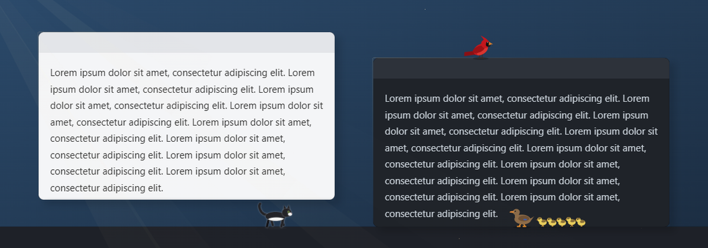

A cardinal, a cat, and ducks share a desktop crossed by sunbeams.

**[Download Deskworlds for Windows](https://github.com/giogardant/deskworlds-releases/releases/latest/download/Deskworlds-Setup.exe)**

Free · About 66 MB · 64-bit Windows 10 or 11 (Windows 10 version 1809 or later)

## What it is

Made by Giovanni for family and friends. No account, no ads, nothing to sign up for. Weather appears over your windows, birds land on window tops, and animals walk along the taskbar. Your existing wallpaper is kept on first run; optional animated wallpapers are available under **World**.

## Install

1. Download [Deskworlds-Setup.exe](https://github.com/giogardant/deskworlds-releases/releases/latest/download/Deskworlds-Setup.exe).
2. Open it. Installation is for your current user and needs no administrator rights.
3. If Windows says **Windows protected your PC**, choose **More info**, then **Run anyway**. The app is not code-signed.
4. Start Deskworlds. The welcome window asks for your city or postal code for the weather. Yuky trots in to greet you.

The installer includes .NET and installs Microsoft WebView2 if it is missing.

## Feature gallery

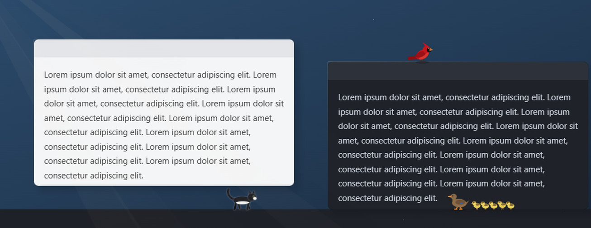

Sunbeams shine past a perched cardinal, a cat, and a line of ducks.

Sunlight follows the calculated sun position. Windows cast soft shadows; cloud shadows drift across screens.

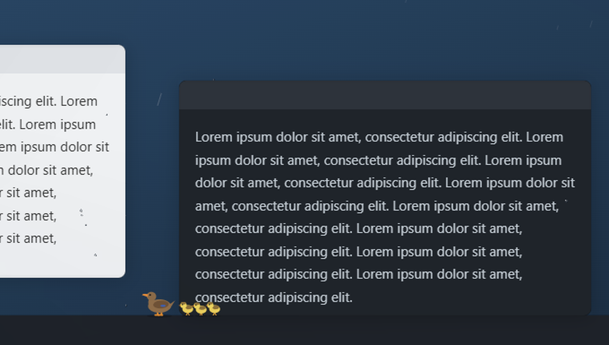

A duck and three ducklings walk beneath windows dotted with rain.

Rain lands on window tops and runs down the glass. Snow and mist are available too.

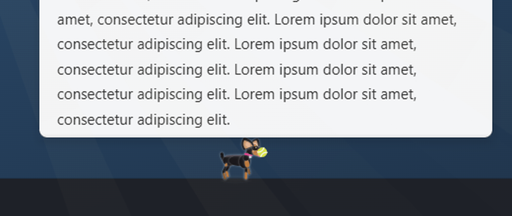

Yuky carries a tennis ball along the taskbar.

Yuky is Giovanni’s miniature pinscher and the app’s mascot. Throw her a ball to play fetch.

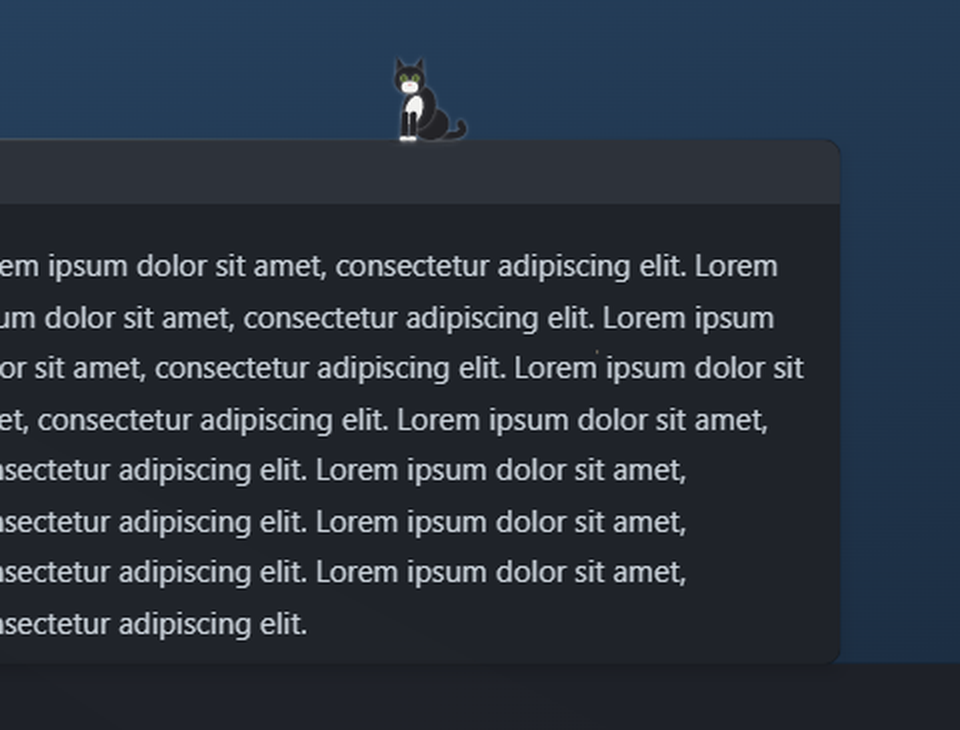

A cat sits on top of a desktop window.

Cats and squirrels climb window edges. Cats can rest on top.

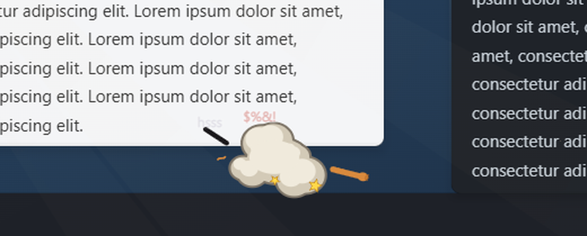

The cat and dog fight in a cartoon dust cloud beside a window.

Cats and dogs scuffle in a cartoon dust cloud. Cats can ride tortoises.

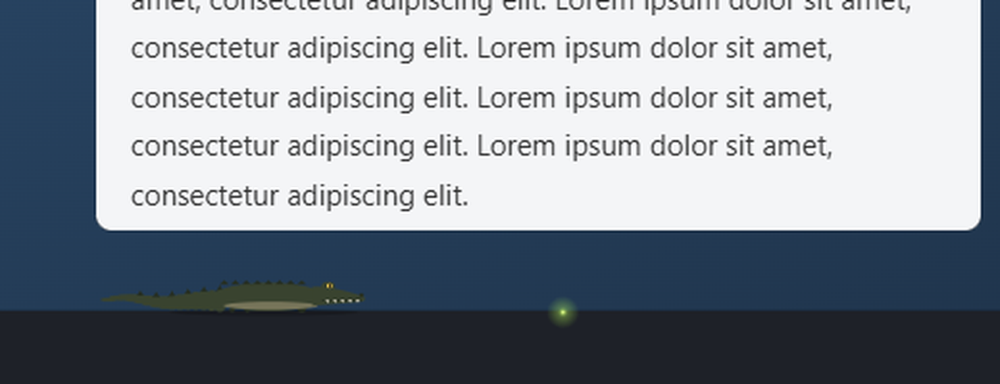

An alligator shares the taskbar with a glowing firefly at night.

Warm clear nights bring fireflies. Armadillos and rare alligators can appear at night.

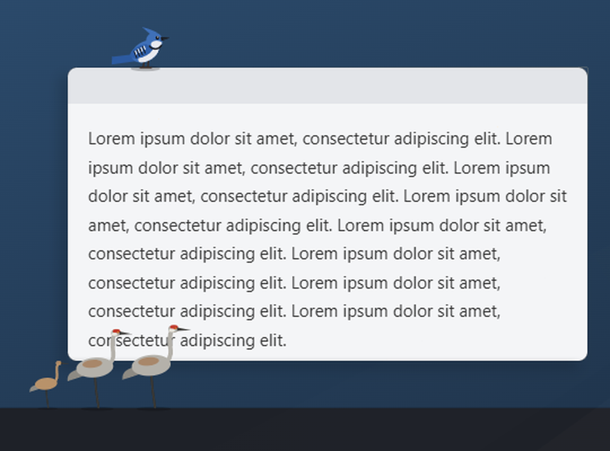

A blue jay perches on a window while cranes stand on the taskbar below.

Birds, hummingbirds and butterflies visit. Rare sightings include sandhill cranes and green anoles.

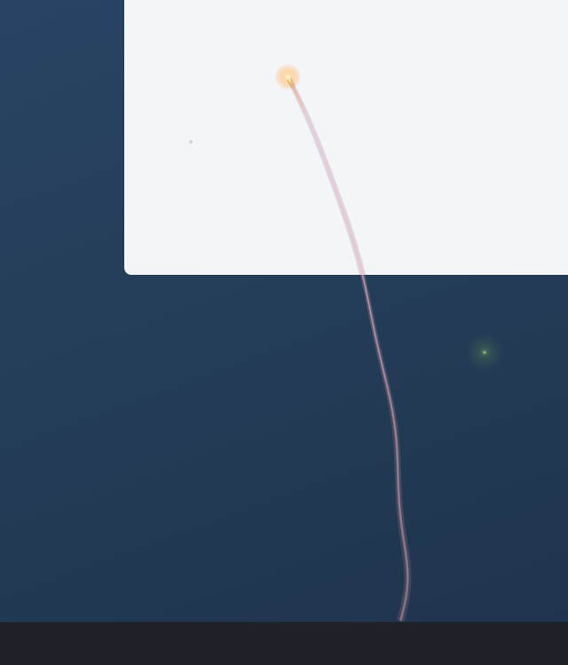

A glowing rocket rises from the taskbar with a long curved trail.

Within about 320 km (200 miles) of Cape Canaveral, a rocket animation follows the scheduled launch time. It depends on the latest schedule and weather; last-minute delays may be missed.

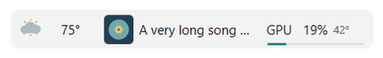

The compact pill shows weather, music, and GPU readings.

The pill shows weather, music and GPU use. Drag it sideways to move it.

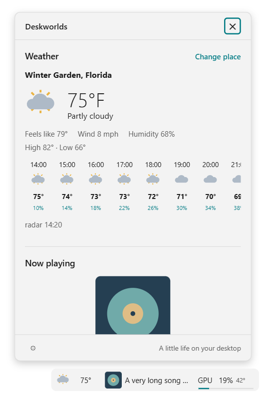

The weather panel shows partly cloudy conditions and an hourly forecast above the compact pill.

Click the weather section for current conditions and the hourly forecast.

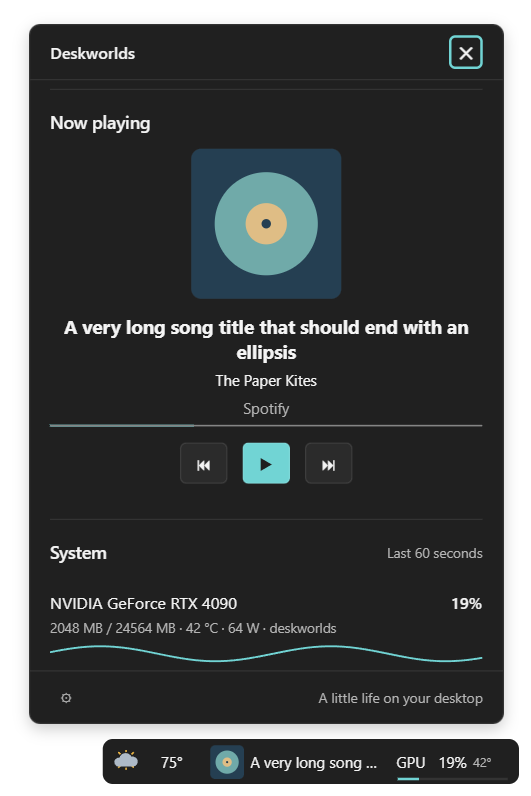

The media panel shows the current song, playback controls, and GPU readings.

Music controls work with Spotify and other players that share media sessions with Windows. No Deskworlds login is needed.

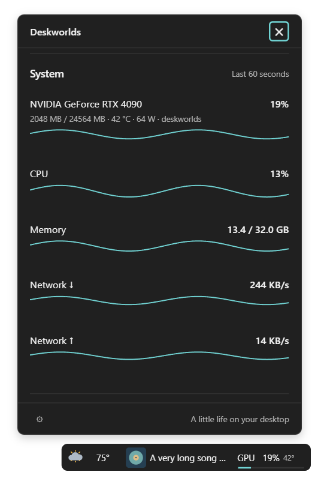

The system panel displays GPU, CPU, memory, and network readings.

The system panel shows GPU, CPU, memory and network readings.

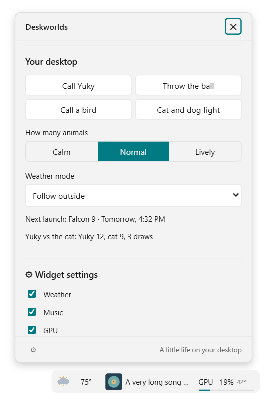

The desktop panel offers animal actions, weather choices, and widget settings.

The desktop panel has animal actions, weather choices and widget settings.

## Using it

- Click an animal to pet it. Drag and drop it to place it; right-click to let it go. Placed animals can fall if their window is shaken or closed. Placements do not survive a restart.
- Find the teal wave icon by the clock (click `^` if hidden). Right-click for the tray menu.
- **Weather** → **Animals** → **Field guide** counts species seen and petting. With the widget on, **Open the panel** leads to animal actions and **How many animals**: **Calm**, **Normal**, **Lively**. With it off, these actions are in the tray, including **Throw the ball**.
- Under **Weather**, use **Effects**, **Follow the weather outside**, **Opposite of outside** or **Choose the weather**. Set your location with **Choose a place…** or **Change place…**.
- **Taskbar widget** toggles the widget. It needs free space on a horizontal taskbar; it hides on auto-hidden taskbars or if no safe gap is found.
- **Start with Windows** controls startup; **Quit** closes the app.

The transparent weather layer passes clicks to your apps except over animal interaction areas. The widget also accepts clicks. Overlays request exclusion from screenshots and recordings by default; capture-tool support can vary. **Weather** → **Show in screenshots and recordings** changes this.

## Updates

Checks start about two minutes after launch, then every 24 hours. Updates download over HTTPS, are checked against the feed’s SHA-256 hash, and install automatically after three minutes without input. The app closes and relaunches, keeping settings and the startup choice. Checks are skipped when Windows reports a metered connection.

Uncheck **Update automatically** to require manual installation; checks and downloads still happen. Use **Check for updates** to check manually. When ready, the tray offers **Install update** followed by the version number.

## Is it safe? / Privacy

The app has no tracking or analytics. It is unsigned, so Windows may show a warning.

Place searches send the city or postal code you type to Open-Meteo. Weather requests send the chosen coordinates to Open-Meteo; RainViewer receives radar tile requests for that area. Launch Library 2 supplies the Cape launch schedule, and GitHub supplies update checks and downloads. If WebView2 is missing, its installer also contacts Microsoft. These services receive ordinary connection information such as your IP address.

Settings, the field guide, browser data and logs are stored locally in `%LOCALAPPDATA%\Deskworlds`.

## Questions

### It is not showing

Check **Pause everything**, **Weather** → **Show on top of windows**, and **Screens** in the tray. Full-screen apps hide overlays on the affected screens. Use **Weather** → **Animals** → **Call an animal** to try a visitor. A maximized window leaves no exposed top for a perched bird.

### How do I pause it?

**Pause the wallpaper** pauses the animated wallpaper, leaving weather, animals and the widget active. **Pause everything** also hides overlays and limits widget sampling; the widget can still show readings. Uncheck it to resume.

### How do I remove it?

In Windows Settings, open **Apps**, find **Deskworlds** under **Installed apps** (Windows 11) or **Apps & features** (Windows 10), and choose **Uninstall**. Settings, the field guide and browser data are kept for a later reinstall.

### Does it slow down my computer?

Usage depends on effects, wallpaper and hardware. One measurement with ambient weather on four monitors was about 0.2 of one CPU core (November 16, 2026); this is not a guarantee. **Pause everything** brings usage close to zero. Animated wallpapers can cost more, especially on laptops.

### Can I use two monitors?

Yes. **Screens** controls which displays are enabled. Weather spans screens, and creatures can cross where screens touch in the Windows display layout, including with different scaling.

### What about games?

Full-screen detection hides and stops overlays on the affected screens. Wallpaper rendering also rests when covered. The widget and host may still work in the background.

## Credits

- Made by Giovanni for family and friends.
- Riverbed, Coral reef, Betta, Plasma globe and Koi pond come from [chaseleantj/deskworlds](https://github.com/chaseleantj/deskworlds) (MIT).
- Weather: [Open-Meteo](https://open-meteo.com/). Radar: [RainViewer](https://www.rainviewer.com/). Launch schedule: The Space Devs’ [Launch Library 2](https://thespacedevs.com/llapi).
- [How it works](docs/HOW-IT-WORKS.md).

This repository holds the installer and documentation; the application source is maintained separately.
