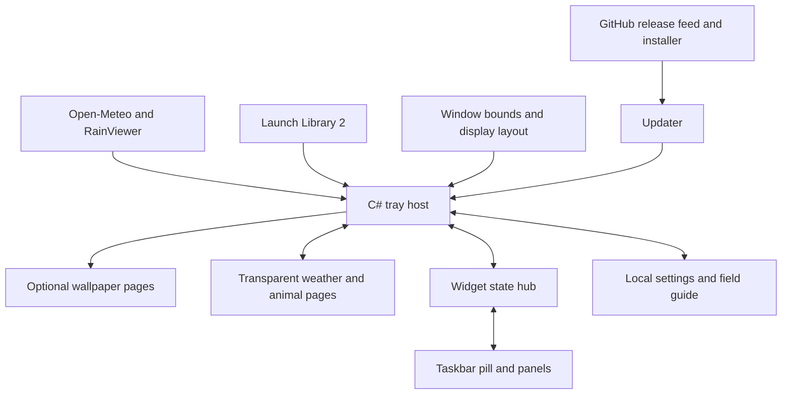

# How Deskworlds works

[English README](../README.md) | [Español](../README.es.md)

Deskworlds combines a C# tray host with local pages displayed by Microsoft WebView2. Optional wallpaper pages sit behind desktop icons. Transparent weather and animal overlays sit above ordinary windows. A separate window displays the taskbar widget.

## Architecture overview

The host manages displays, settings, window tracking, weather requests and updates. WebView2 draws the pages, using DirectComposition for transparent overlays and the widget. The installer includes .NET and installs WebView2 if needed; WebView2 is a separate runtime, not a guaranteed built-in component of every supported Windows installation.

Local assets use a WebView2 virtual host, `https://deskworlds.local/`. This maps to installed files rather than an internet site or an open web server.

## Transparent click-through overlays

There is one overlay per enabled screen. It uses `WS_EX_LAYERED | WS_EX_TRANSPARENT` and a WebView2 composition surface for transparent pixels. At creation, the host tests click pass-through with `WindowFromPoint`. A failed test disables the overlays. A periodic check keeps them above ordinary windows without taking focus.

Full-screen detection hides and stops overlays on affected displays. Exclusive full-screen or presentation mode can suppress all displays. Locking the session, turning displays off, or choosing **Pause everything** also stops overlays.

By default, the host requests `WDA_EXCLUDEFROMCAPTURE`. This asks compatible capture tools to omit the overlays; it is not a guarantee for every recording method. **Weather** → **Show in screenshots and recordings** changes the setting.

## Windows as surfaces

The host enumerates visible, non-minimized windows and taskbars in front-to-back order. Window handles identify surfaces as they move. Bounds are converted from desktop coordinates into each overlay’s CSS pixels.

Surface polling is adaptive: roughly every 60 milliseconds while effects need window updates or a window is being dragged, otherwise every 250 milliseconds. It stops when overlays are stopped.

Rain lands on window tops, gathers on glass and drips from edges. Drops move with their window and can fly off when it is flung. Snow settles on ledges and falls when windows move. Window edges also give birds perches and cats and squirrels climbing routes.

The pages calculate sun position from time and coordinates locally. Lakeside also calculates moon position and phase locally; Open-Meteo does not supply that astronomy. Cached, reduced-resolution canvases draw window shadows. Cloud shadows share desktop coordinates so they line up across monitors. Overcast light blends toward soft shadows beneath windows. Warm clear nights can bring fireflies.

## Weather, radar and launches

Weather requests run every ten minutes when a weather world, overlay or widget needs them and a place is set. Open-Meteo supplies current conditions and forecast data. The host derives the drawing’s rain, snow, fog and storm values from those readings. Searching for a city or postal code sends the entered text to Open-Meteo’s geocoding service.

RainViewer is checked every three minutes. Radar tiles are downloaded when a new frame is available and decoded into reflectivity values. A frame no older than 25 minutes can override modeled rain, except when the model reports snow:

- At least 18 dBZ within 1.6 km produces rain, with intensity estimated using the Marshall–Palmer relation.
- No overhead echo means no rain, even when the model predicts it.
- At least 30 dBZ within 12 km can thicken clouds.
- Lightning requires rain overhead.

Launch Library 2 supplies upcoming Cape Canaveral launches. With overlays and launch effects enabled, a chosen place within roughly 320 km triggers schedule checks hourly, or every five minutes within 90 minutes of a launch. Checks stop during **Pause everything**.

The launch timer runs every 15 seconds. A launch marked `Go` can trigger once within 30 seconds of its scheduled time. This is a schedule-based animation, not live confirmation of liftoff; a last-minute scrub may be missed. Rain or clouds can hide a real launch animation. **Weather** → **Animals** → **Watch a launch now** plays a rehearsal at three times the normal speed.

## Animals and movement between screens

Each overlay schedules visits, while the host shares roaming counts across screens. The pace choices are approximate random intervals, not appointments:

| Choice | Typical visit interval | Roaming crowd target |
|---|---|---|
| Calm | About 10 minutes | 2 |
| Normal | About 3–4 minutes | 3 |
| Lively | About 1 minute | 6 |

Placed animals do not count toward that roaming target. Birds and butterflies visit exposed window tops. Taskbar visitors include cats, squirrels, mallards with ducklings, tortoises, armadillos and Yuky. Cats and squirrels climb suitable window sides; spider monkeys can climb and hang from corners. Encounters can produce chases, cartoon fights or tortoise rides. Rare sightings include cranes, anoles and nighttime alligators.

When Yuky’s daily routine is enabled, five minutes without input can bring a nap on the primary taskbar. After 90 minutes of activity she can bring her leash, no more often than every two hours. These checks use Windows idle time.

The host computes “doors” where enabled screen edges touch. When a creature crosses one, the page reports a handoff and the host forwards it to the neighboring overlay. Coordinates and motion are translated for that screen’s scaling. Birds can also cross vertically between stacked displays.

## Petting and placing animals

The page reports animal interaction boxes about ten times a second. While the pointer is over a target, a nearly transparent, non-activating native window called `Catcher` receives the interaction. The rest of the overlay remains click-through.

Clicks trigger petting reactions. Dragging captures the pointer and can transfer the animal across screens. Dropping places it on the taskbar, a nearby window top or elsewhere on screen. Right-clicking releases it. A placed animal can fall when its supporting window is shaken or closed. Placements are not saved across restarts.

## Taskbar widget and shared state

The widget is a separate native window hosting the local widget page. An off-thread UI Automation worker finds a safe gap between taskbar buttons and the notification area. It supports horizontal taskbars, opens downward from a top taskbar, and hides when space cannot be established, the taskbar auto-hides or a full-screen app occupies that display.

The `Hub` holds widget state sections, sends changed sections to widget pages and routes actions back to the controller. It shares weather, settings, animal information, media and system readings with the panels; it is not a separate settings database.

Media comes from Windows media sessions. Spotify and other players work when they expose a compatible session; there is no Deskworlds account or player login. GPU, CPU, memory and network readings come from local Windows measurements. Sampling depends on widget visibility, open panels and selected chips. **Pause everything** limits sampling to visible chips rather than disabling the widget.

With the widget enabled, **Weather** → **Animals** offers **Open the panel** instead of duplicating the bird, Yuky, ball, fight and pace actions. Other animal menu items remain available.

## Updates and release feed

The default [release feed](https://github.com/giogardant/deskworlds-releases/releases/latest/download/latest.json) contains `version`, `url`, `sha256`, `notes` and optional `notes_es`. The URL can be relative to the feed. Settings or the `DESKWORLDS_FEED` environment variable can override the feed.

Checks begin about two minutes after startup and then every 24 hours. The updater skips checks when Windows reports a metered connection. Public feeds and installers require HTTPS, including redirects; the code permits HTTP for loopback test servers.

Downloads are checked against the feed’s SHA-256 hash before execution. This detects a file that differs from the feed; it is not a code signature. Failed partial downloads are cleaned up on retries. With **Update automatically** checked, a ready installer runs after at least three minutes without input. The app closes, the silent installer preserves settings and the startup choice, and the app relaunches.

Turning **Update automatically** off leaves checks and downloads enabled but requires manual installation. The tray shows **Install update** followed by the available version when ready.

## Performance budget

Wallpaper pages and overlays have different rendering policies.

| Wallpaper visibility or state | Requested frames per second |
|---|---|
| At least 40% visible | 60, or 30 on battery |
| At least 15% but less than 40% visible | 20 |
| Less than 15% visible, paused, locked or display off | 0 |

With **Rest while the GPU renders** enabled and monitoring available, sustained use above 40% by another process on the watched GPU pauses wallpaper rendering after two hot samples. It resumes after 15 quiet seconds. This policy does not stop weather overlays.

Overlays request at most 30 frames per second. Their page selects up to 30 for action, 15 for nighttime effects, 4 for ambient light or placed animals, and 0 when nothing needs drawing. **Pause the wallpaper** leaves these overlays and the widget running. **Pause everything** stops wallpaper and overlays and reduces widget sampling; background timers and visible readings can remain active.

The developer budget targets under 0.5 of one CPU core with ambient weather across four screens, under 0.1 core while everything is paused, and host private-memory growth under 0.05 MB per minute. These are targets, not guarantees. The brief reports about 0.2 core for ambient weather on four monitors on November 16, 2026. Optional animated worlds can use substantially more GPU time.

## Storage and privacy

The default data folder is `%LOCALAPPDATA%\Deskworlds`:

| Path inside the data folder | Contents |
|---|---|
| `settings.json` | Place, preferences, effects and update settings |
| `journal.json` | Field guide, sightings and petting records |
| `deskworlds.log` | Diagnostic log |
| `WebView2/` | Browser profile and local page data |
| `updates/` | Downloaded installers and partial downloads |

The installer places application files in `%LOCALAPPDATA%\Programs\Deskworlds` for the current user. Uninstalling keeps settings, the field guide and browser data for a later reinstall.

There is no app tracking or analytics. Network requests include place searches and forecasts to Open-Meteo, radar requests to RainViewer, schedules from Launch Library 2, and update checks and downloads from GitHub. Installing a missing WebView2 runtime also contacts Microsoft. External services receive normal connection metadata, including the IP address.
